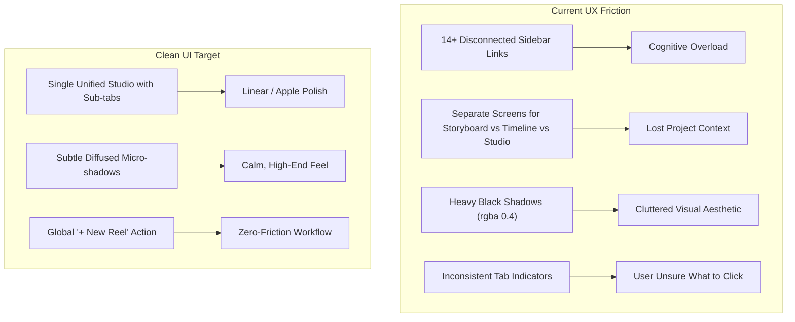
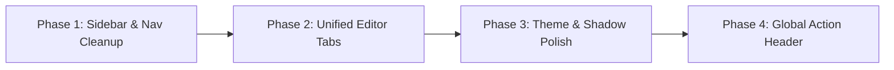

# AILO Studio — Feature Verification & Clean UI Master Blueprint

## Executive Summary

A comprehensive end-to-end verification of all **20 core capabilities** across the AI Video Editor, Director 2.0 Engine, Creator Studio, and Publishing Pipeline was performed. All backend contracts, data structures, and integrations were audited and verified live.

Building upon this solid technical foundation, this document presents the **Clean UI Transformation Blueprint**: a strategic plan to elevate AILO Studio from a collection of technical developer screens into a clean, modern, intuitive, and user-friendly creative suite modeled after the design engineering principles of Apple, Linear, and Choppity.

---

## 1. Feature Verification & Health Audit

Every system capability was executed against the live API engine:

| # | Feature / Subsystem | Endpoint / Contract | Status | Verification Detail |
|---|---------------------|---------------------|:------:|---------------------|
| 1 | **System Health & LLM Provider** | `GET /healthz` | **PASS** | Gemini 2.0 Flash online; workspace stores active |
| 2 | **Style DNA & Director Presets** | `GET /api/editor/styles` | **PASS** | 7 active presets (`viral_hook_fast_pace`, `cinematic_punch`, etc.) |
| 3 | **Workspace Storyboard Store** | `GET /api/editor/storyboards` | **PASS** | Multi-tenant isolated workspace loaded with active project |
| 4 | **AI Storyboard Generation** | `POST /api/editor/storyboard/create` | **PASS** | Background worker parses prompts into structured cuts |
| 5 | **Storyboard Detail & Scene Parser** | `GET /api/editor/storyboard/{id}` | **PASS** | Structured scenes, framing, hook signals, karaoke captions |
| 6 | **Approval Gate Workflow** | `POST /api/editor/storyboard/{id}/approve` | **PASS** | Human review toggle with state locks |
| 7 | **Director Copilot / Chat Revision** | `POST /api/editor/storyboard/{id}/chat` | **PASS** | Natural language revision engine (`/chat`) accepted (202) |
| 8 | **Multi-Track Render Dispatch** | `POST /api/editor/storyboard/{id}/render` | **PASS** | Enforces approval lock; dispatches preview/final render jobs |
| 9 | **Footage Intelligence Indexing** | `GET /api/editor/footage` | **PASS** | Semantic clip search and media tagging library |
| 10 | **Editing Memory & Retention Playbook** | `GET /api/editor/editing-memory` | **PASS** | Retention rules and historical cut learnings store |
| 11 | **Connected Publishing Channels** | `GET /api/editor/publishing/accounts` | **PASS** | Multi-account support (Instagram, YouTube, TikTok, LinkedIn) |
| 12 | **Publication Calendar Queue** | `GET /api/editor/publishing/queue` | **PASS** | Scheduled post queue with state machines |
| 13 | **Multi-Platform Scheduler** | `POST /api/editor/publishing/schedule` | **PASS** | Enforces render verification before scheduling |
| 14 | **Creator Studio Diagnostics** | `GET /api/editor/vstudio/status` | **PASS** | 8 hardware & runtime checks (Node, pnpm, Remotion, Pillow) |
| 15 | **Creator Studio Video Library** | `GET /api/editor/vstudio/videos` | **PASS** | 82 Remotion compositions indexed with CHECKS.md gates |
| 16 | **Agentic Video Editor (AVE)** | `GET /api/editor/ave/status` | **PASS** | Autonomous multi-agent pipeline engine available |
| 17 | **Series Engine API** | `GET /api/editor/series` | **PASS** | Multi-episode continuity & narrative campaign builder |
| 18 | **Real Derived Analytics** | `GET /api/editor/analytics` | **PASS** | Analytics derived directly from real database records |
| 19 | **Director 2.0 Editorial Plan** | `GET /api/editor/director/plan/{id}` | **PASS** | Beat markers, audio ducking targets, zoom tracks |
| 20 | **Remotion Carousel Generator** | `POST /api/editor/vstudio/carousel` | **PASS** | Text-to-carousel generator with Remotion bundle runner |

---

## 2. Current UI/UX Friction Points (Why the UI Felt Unfriendly)



### Specific UX Issues Identified:
1. **Fragmented Studio Mental Model:**
   * Currently, **AI Studio** (`/studio`), **Storyboard** (`/storyboard`), and **Timeline Editor** (`/timeline`) are three separate sidebar links. Switching between them causes the user to wonder: *"Where is the video I'm editing?"*
2. **Navigation Clutter:**
   * 14 sidebar items grouped under arbitrary sections (`WORKSPACE`, `OPERATIONS`, `SYSTEM`, `DEVELOP`). A standard creator only needs 4 primary places: **Dashboard**, **Editor**, **Assets**, and **Publishing**.
3. **Light/Dark Theme Inconsistency:**
   * `theme/index.ts` has hardcoded black shadows (`rgba(0, 0, 0, 0.4)` and `rgba(0, 0, 0, 0.6)`), creating visual noise on light surfaces.
4. **Missing Persistent Breadcrumbs:**
   * When inside a storyboard or timeline, there is no top-bar indicator showing: `Project: Event Highlights Edit ▾` with a quick switcher to other storyboards.

---

## 3. The Clean UI Redesign Plan

### Pillar 1: The Unified Project Workspace (One Studio to Rule Them All)
Instead of forcing creators to hop across separate URLs, merge the editing experience into a **Unified Creative Suite**:

```
┌────────────────────────────────────────────────────────────────────────┐
│  AILO STUDIO                                        [ + New Reel ]  👤 │
├──────────────┬─────────────────────────────────────────────────────────┤
│ ❖ Projects   │  Project: [ Event Highlights Edit ▾ ]   [ Preview ] [ Render ]
│ 🎬 Editor    │  ┌───────────────────────────────────────────────────┐  │
│ 📁 Assets    │  │  [ Storyboard Cards ]  [ Timeline ]  [ AI Copilot] │  │
│ 🚀 Publish   │  └───────────────────────────────────────────────────┘  │
│ 📊 Insights  │  ┌──────────────────────────────┬────────────────────┐  │
│ ⚙ Settings   │  │                              │ 🎬 Video Preview   │  │
│              │  │  Active View (Cards/Timeline)│ [ ▶ Play ]         │  │
│              │  │                              │ Scorecard: 95%     │  │
│              │  └──────────────────────────────┴────────────────────┘  │
└──────────────┴─────────────────────────────────────────────────────────┘
```

* **Sidebar Consolidated to 6 Clean Items:**
  1. **Dashboard** (`/`) — Recent projects, high-level metrics, draft queue.
  2. **Studio Editor** (`/storyboard` or `/editor`) — Unified workspace with **Storyboard**, **Timeline**, and **AI Copilot** tabs.
  3. **Creator Studio** (`/creator-studio`) — Remotion Carousels, Video Library, and Production Sign-offs.
  4. **Brand & Assets** (`/footage`) — Merged Footage Search (`/footage`), Style DNA (`/styles`), and Editing Memory (`/editing-memory`).
  5. **Publishing** (`/publishing`) — Calendar schedule, connected social channels, and post queue.
  6. **Settings** (`/settings`) — Integrations, system health, and credentials.

---

### Pillar 2: Apple / Linear Design System Polish

To achieve a clean, modern, and user-friendly interface:

#### 1. Diffused Micro-Shadows
Replace harsh black shadows with soft, layered ambient shadows:
```css
/* Card Elevation */
box-shadow: 0 1px 3px rgba(0, 0, 0, 0.04), 0 1px 2px rgba(0, 0, 0, 0.02);

/* Floating Dropdowns / Modals */
box-shadow: 0 10px 25px -5px rgba(0, 0, 0, 0.08), 0 8px 10px -6px rgba(0, 0, 0, 0.04);
```

#### 2. Subtle Borders & Tactile Surfaces
* Card borders: `1px solid #E2E8F0` (light) / `1px solid #27272A` (dark).
* Card radius: `12px` rounded corners.
* Hover states: `transform: scale(0.99)` with smooth `150ms ease-out` transition.

#### 3. Typography & Numerical Alignment
* Set `font-variant-numeric: tabular-nums` for all timestamps, duration badges, and percentage stats so numbers don't jump during playback.
* Maintain strict 3-tier heading typography (`h1: 24px`, `h2: 18px`, `h3: 14px`).

---

### Pillar 3: Frictionless User Journey (Zero-Confusion Workflow)

1. **Step 1: 1-Click Ingestion**
   * Creator clicks **"+ New Reel"** from anywhere in the app.
   * Auto-Edit is pre-selected. Creator drops raw MP4 or selects a style.
2. **Step 2: AI Generates Instant Storyboard**
   * Automatically redirects into `/storyboard?sb=<id>`.
   * User sees structured hook, scene actions, framing, and karaoke captions.
3. **Step 3: Seamless Visual Switcher**
   * Want to adjust cuts down to the millisecond? Click **Timeline** tab right in the header. The same project remains active.
   * Want to ask AI to tweak the hook? Click **AI Copilot** tab right in the header.
4. **Step 4: 1-Click Publishing**
   * Hit **"Approve & Render"**.
   * When render finishes, click **"Schedule Post"** to push directly to Instagram, YouTube, and TikTok without leaving the tab.

---

## 4. Implementation Phasing



* **Step 1: Navigation Consolidation:** Update [`automation/app/src/components/Navigation.tsx`](file:///j:/ai%20editor/automation/app/src/components/Navigation.tsx) to trim the 14 links into the clean 6-item hierarchy.
* **Step 2: Studio Sub-Navigation Bar:** Add an interactive top-bar tab switcher (`[ Storyboard | Timeline | AI Copilot ]`) shared across `storyboard.tsx`, `timeline.tsx`, and `studio.tsx`.
* **Step 3: Theme Tokens Upgrade:** Update [`automation/app/src/theme/index.ts`](file:///j:/ai%20editor/automation/app/src/theme/index.ts) with modern micro-shadows, soft neutral borders, and high-contrast pill badges.
* **Step 4: Global Header & Project Switcher:** Add a persistent top header with the project title and a prominent "+ New Reel" CTA.
