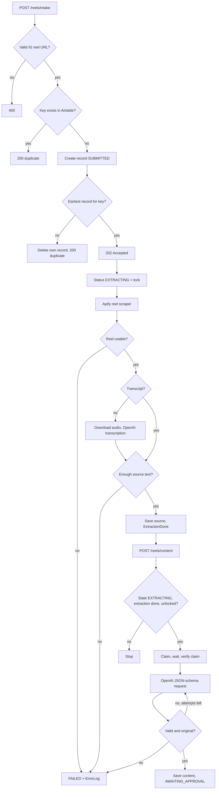
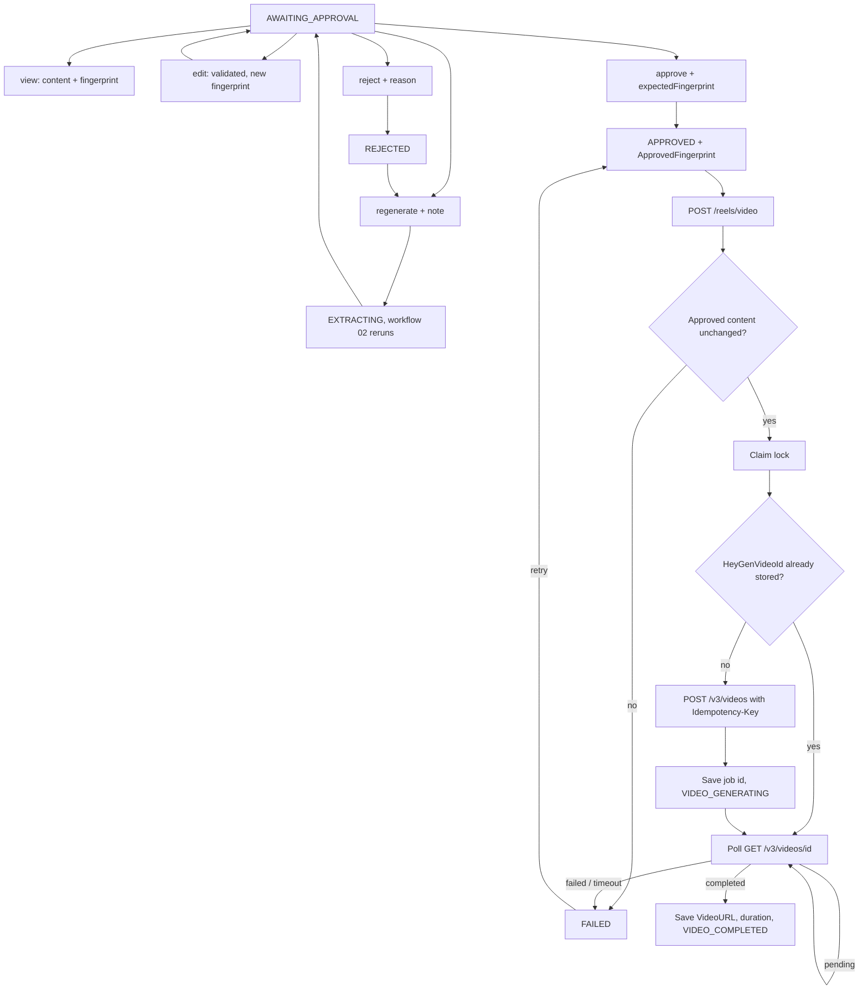
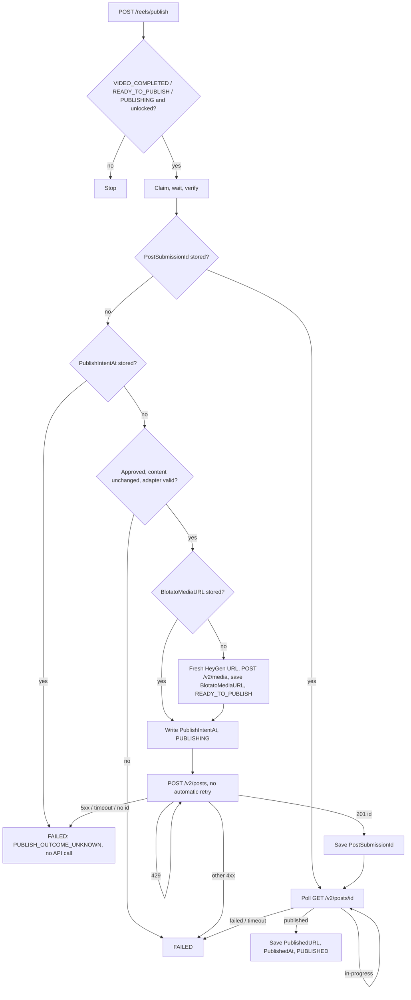

# Reel intake, content, approval, HeyGen video and Instagram publishing (n8n)

Seven importable workflows that take an Instagram Reel URL (or an already finished video), extract it with Apify, generate original content with OpenAI, hold it for human approval, render an avatar video with HeyGen, and publish it as an Instagram Reel through a modular publishing adapter (Blotato API or a mock), recording every result in Airtable. Global error management / stuck-record sweeping (workflow 08) is **not** built yet. The dashboard backend (`../server/`, see `../docs/setup-and-deployment.md`) drives these workflows through their webhooks.

**Verification status:** the workflows have been run only against a simulated n8n runtime and mock services (`test/n8n-sim.cjs`, `mock/mock-server.cjs`). They have **not** been imported into real n8n and have **not** called real Apify, OpenAI, Airtable, HeyGen or Blotato. See [Integration status](#integration-status).

## Files

| File | Purpose |
|---|---|
| `01-reel-intake.json` | `POST /webhook/reels/intake`: validate, deduplicate, create the record, scrape, transcribe, save source, trigger workflow 02 |
| `02-content-generation.json` | `POST /webhook/reels/content`: claim the record, generate and validate content, save, set `AWAITING_APPROVAL` |
| `03-human-approval.json` | `POST /webhook/reels/approval`: `view`, `edit`, `approve`, `reject`, `regenerate`, `retry`, `publish`. Also `POST /webhook/reels/intake-retry` is in workflow 01 (internal) |
| `04-heygen-video.json` | `POST /webhook/reels/video` (internal): submit the approved script to HeyGen, poll the job, store the video, update Airtable |
| `05-instagram-publishing.json` | `POST /webhook/reels/publish` (internal): stage the video with Blotato, create the Instagram Reel post once, track it to `PUBLISHED`, store the post id and result |
| `06-video-upload-intake.json` | `POST /webhook/reels/upload` (internal): validate an uploaded video's metadata, deduplicate by file hash, create an `AWAITING_APPROVAL` record (no extraction, no HeyGen) |
| `07-integration-status.json` | `POST /webhook/reels/status` and `POST /webhook/reels/options` (internal): probe n8n, Airtable, Apify, OpenAI, HeyGen and Blotato with the stored credentials, list HeyGen avatars and voices. Never returns a credential |
| `build/generate-workflows.cjs` | Generates all JSON files. Do not hand-edit the JSON; edit the generator and run `npm run build` |
| `../lib/core.js` | Pure logic (validation, state machine, request builders). The generator embeds only the functions each Code node uses |
| `../env.example` | Environment variables (placeholders only) |
| `../docs/airtable-schema.md` | Airtable table |

## Flow



### Approval and video

The pause is the Airtable state `AWAITING_APPROVAL`, not a suspended n8n execution: nothing downstream runs until the approval webhook moves the record on, and the pause survives n8n restarts.



### Publishing (workflow 05)

The sequence follows Blotato's published OpenAPI (`research/blotato/`): `POST /v2/media` (`{url}` returns a Blotato-hosted `url`), `POST /v2/posts` (Instagram, `mediaType: reel`, returns `postSubmissionId`), then `GET /v2/posts/{postSubmissionId}` until `published` or `failed`. Auth is the `blotato-api-key` header via the `Blotato API Key` credential.



**Adapter switch.** `PUBLISH_ADAPTER=mock` (default) needs `MOCK_PUBLISH_BASE_URL` and refuses any Blotato host. `PUBLISH_ADAPTER=blotato` needs `BLOTATO_ACCOUNT_ID` and is pinned to `https://backend.blotato.com`. Anything else fails with `ADAPTER_CONFIG_INVALID` / `ADAPTER_NOT_IMPLEMENTED` before any API call. The workflow itself does not change: the adapter only supplies the base URL and account id, and the `Blotato API Key` credential supplies the key. Going live later means creating that credential with an authorised key and changing the environment variables; no key exists in this repository.

**Duplicate-publishing prevention.** `POST /v2/posts` has no idempotency key in the OpenAPI, so n8n must never retry it blindly:

1. Only `VIDEO_COMPLETED`, `READY_TO_PUBLISH` and `PUBLISHING` records proceed, with the same claim, wait, verify lock as the other workflows. `PUBLISHED` records are skipped.
2. `Create Post` has **no** n8n retry. `PublishIntentAt` is written first. A 429 (rate limit, nothing created) is retried by an explicit loop (`MAX_POST_CREATE_ATTEMPTS`); other 4xx answers mean not created and clear the intent; a 5xx, timeout, or answer without `postSubmissionId` is **ambiguous** and ends in `FAILED` with `PUBLISH_OUTCOME_UNKNOWN`, never an automatic re-post.
3. A stored `PostSubmissionId` is only tracked, never re-created. A stored intent without an id is never re-posted (a crash between the intent and the response lands here).
4. A new post is created only after Blotato itself reports `failed`, which clears the id and intent. Poll timeouts keep the id.

**Operator procedure for `PUBLISH_OUTCOME_UNKNOWN`:** check Blotato (dashboard / API activity; the exact place to look is unverified) for a post for this reel around `PublishIntentAt`. If it exists, set `PostSubmissionId` to its submission id and call `retry`; workflow 05 then tracks it. If it does not exist, clear `PublishIntentAt` and call `retry`. If the id could not be saved after a successful create, it is in the `ErrorLog` entry (`postSubmissionId`).

**Opt-in.** `AUTO_PUBLISH` now defaults to `false` (it previously defaulted to true in the config helper, with nothing wired to it). With `AUTO_PUBLISH=true`, workflow 04 triggers workflow 05 after saving the video; otherwise call `POST /webhook/reels/publish` with `{"recordId":"rec..."}`. A failed trigger leaves the record `VIDEO_COMPLETED`.

**Video URL freshness.** HeyGen URLs are presigned. Workflow 05 re-reads `GET /v3/videos/{id}` at publish time and falls back to the stored `VideoURL`.

## Safeguards

- **Input validation:** HTTPS `instagram.com/(reel|reels|p)/<code>` only, with a strict code pattern. The Airtable filter formula is built from the validated key only.
- **Webhook auth:** both webhooks require a Header Auth credential.
- **Duplicates:** the key `ig_<shortCode>` is looked up first. After creating, the workflow re-lists by key sorted by `CreatedTime`. If its record is not the earliest, it deletes its own record and returns the existing one. Airtable cannot enforce uniqueness, so this is best-effort, not a hard guarantee.
- **Duplicate content runs:** workflow 02 checks state, `ExtractionDone` and lock age, writes `LockedBy`, waits 2 seconds, re-reads, and continues only if its execution ID still holds the lock. This is an optimistic lock; Airtable has no compare-and-swap.
- **Retries:** HTTP nodes use n8n's retry-on-fail (3 tries; 2 for audio). n8n retries every error type, including 4xx. Content validation failures are retried by a loop (up to `MAX_CONTENT_ATTEMPTS`, default 3) that feeds the validation errors back into the prompt. Refusals and truncated output are not retried.
- **Structured output:** OpenAI is called with `response_format: json_schema` (strict). The reply is parsed and validated again in code: word count for the target duration, caption length, hashtag format and count, overlay length, placeholders, URLs, and 5-gram overlap with the source (originality check).
- **Failure handling:** every node that can fail routes its error output to a `Fail: <step>` node that classifies the error, appends a redacted entry to `ErrorLog`, sets `Status=FAILED` with `FailedFromState`, and releases the lock. Optional notification via `NOTIFY_WEBHOOK_URL`.
- **No secrets in JSON:** credentials are referenced by name; Code nodes read only non-secret config from `$env`.
- **Approval integrity:** `approve` requires `expectedFingerprint` (hash of script, caption, overlay and hashtags as returned by `view`/`edit`), so only content the approver has seen can be approved. The approved fingerprint is stored, and workflow 04 recomputes it before spending anything. A record set to `APPROVED` by hand, or edited after approval, fails with `NOT_APPROVED` / `CONTENT_CHANGED_AFTER_APPROVAL` and never reaches HeyGen. Content is re-validated at approval time.
- **Concurrent approvals:** approval actions take the same optimistic lock (`approval:<execution id>`, wait, re-read, decide). Approve and reject at the same time yield one outcome; a repeated approve or reject returns `duplicate: true` and does not trigger anything. A record locked by the video worker returns `423 RECORD_BUSY`.
- **No duplicate HeyGen jobs:** (1) only `APPROVED` or `VIDEO_GENERATING` records proceed; (2) a lock (30 minutes, refreshed on every poll) with the same claim, wait, verify sequence; (3) the job id is saved before polling and a stored id is resumed, never resubmitted; (4) `POST /v3/videos` sends `Idempotency-Key: <reelKey>:heygen:<approvedFingerprint>:<attempt>`, so n8n's HTTP retries and a retry after a failed save replay the same job; (5) a new job is created only after a *terminal* HeyGen failure, which clears the id and increments `VideoAttempt`, capped by `MAX_VIDEO_ATTEMPTS`. Poll timeouts keep the id and attempt so a retry resumes the same job.
- **Regeneration:** `regenerate` (from `AWAITING_APPROVAL` or `REJECTED`) stores the reviewer note, increments `RegenerationCount` (cap `MAX_REGENERATIONS`) and re-runs workflow 02, which feeds the note into the prompt.
- **Polling:** every `HEYGEN_POLL_SECONDS` (default 10, backing off to `HEYGEN_POLL_CAP_SECONDS`) up to `MAX_POLL_ATTEMPTS`. Waits of 60 s or less keep the n8n execution running; each poll writes a heartbeat (`PollAttempts`, `HeyGenStatus`, `LockedAt`). HeyGen webhooks are not used because their event names and signing scheme are unverified.
- **Output checks:** the finished video needs an HTTPS URL and a duration between `MIN_VIDEO_SECONDS` and `MAX_VIDEO_SECONDS`, otherwise it is treated as a failed job.

## Setup

1. Create the Airtable table per `../docs/airtable-schema.md`.
2. In n8n, set the environment variables from `../env.example`. `$env` access in nodes must be allowed (`N8N_BLOCK_ENV_ACCESS_IN_NODE=false`).
3. Create credentials with these exact names, then import both JSON files and open each node that shows a credential warning:

| Credential name | Type | Value |
|---|---|---|
| Airtable Personal Access Token | Airtable Personal Access Token | PAT with `data.records:read`, `data.records:write` on the base |
| Apify API Token | Header Auth | Name `Authorization`, value `Bearer <apify token>` |
| OpenAI API | OpenAI | API key |
| Reels Intake Webhook Auth | Header Auth | Name `X-Reels-Token`, value a long random string |
| Reels Internal Webhook Auth | Header Auth | Name `X-Reels-Token`, a different long random string |
| Reels Approval Webhook Auth | Header Auth | Name `X-Reels-Token`, a third random string, given only to approvers |
| HeyGen API Key | Header Auth | Name `x-api-key`, value your HeyGen API key |
| Blotato API Key | Header Auth | Name `blotato-api-key`, value an authorised Blotato API key. Only needed for `PUBLISH_ADAPTER=blotato`; for the mock use the fake value `sim-blotato`. Never put a real key in a mock setup |

4. Set `HEYGEN_AVATAR_ID` and `HEYGEN_VOICE_ID` (see `../env.example`; the dashboard can also choose them per reel). Activate all seven workflows. Test intake with:

```
curl -X POST "$N8N_WEBHOOK_BASE/webhook/reels/intake" -H "X-Reels-Token: <intake secret>" -H "Content-Type: application/json" -d '{"url":"https://www.instagram.com/reel/XXXXXXXXXXX/"}'
```

Use only reels you are authorised to process, and write your own original scripts; the pipeline rejects output that is too similar to the source.

## Approval API

All calls are `POST $N8N_WEBHOOK_BASE/webhook/reels/approval` with header `X-Reels-Token: <approval secret>` and a JSON body containing `recordId` and `action`. `actor` is a free-text name stored as `ApprovedBy` / `LastActionBy`; it is **self-asserted**, not verified identity.

| Action | Extra body fields | Result |
|---|---|---|
| `view` | none | `200` with `content` (script, caption, overlay, hashtags), `fingerprint`, `status` |
| `edit` | any of `script`, `caption`, `overlay`, `hashtags`; optional `expectedFingerprint` | `200` with the new `fingerprint`; `422 CONTENT_INVALID` with reasons if validation fails (record unchanged) |
| `approve` | `expectedFingerprint` (required) | `202`, status `APPROVED`, video workflow triggered; `409 STALE_CONTENT` if the content changed |
| `reject` | `reason` (required) | `200`, status `REJECTED` |
| `regenerate` | optional `note`, `expectedFingerprint` | `202`, status `EXTRACTING`, workflow 02 triggered |
| `retry` | none | for `FAILED` records: extraction failures restart from the saved URL, content failures from the saved extraction, video and publish failures re-trigger workflow 04 or 05 |
| `publish` | `expectedFingerprint` (required) | only from `VIDEO_COMPLETED` with a matching approved fingerprint: `202`, workflow 05 triggered. `READY_TO_PUBLISH`, `PUBLISHING` and `PUBLISHED` return `200 duplicate` and trigger nothing |

For uploaded videos (`SourceType=upload`) `approve` goes straight to `VIDEO_COMPLETED` (it triggers publishing only if `AUTO_PUBLISH=true`), `edit` accepts caption, overlay and hashtags but not a script, and `regenerate` is refused.

```
curl -X POST "$N8N_WEBHOOK_BASE/webhook/reels/approval" -H "X-Reels-Token: <approval secret>" -H "Content-Type: application/json" -d '{"action":"view","recordId":"recXXXXXXXXXXXXXX","actor":"alice"}'
curl -X POST ... -d '{"action":"approve","recordId":"recXXXXXXXXXXXXXX","actor":"alice","expectedFingerprint":"<from view>"}'
```

Error codes: `400` invalid input, `403` bad token, `404` unknown record, `409` wrong state / stale content / limit reached, `422` content invalid, `423` record busy.

## Testing

```
cd automation
npm run build   # regenerate JSON
npm test        # 191 tests: unit, workflow structure, simulated workflows, dashboard backend over HTTP
npm run mock    # optional: run the mock services standalone on :4010
npm run dev:stack  # mock providers + simulated n8n + dashboard backend on :8787 (for frontend development)
```

To run n8n against the mock services, point `AIRTABLE_BASE_URL`, `APIFY_BASE_URL`, `OPENAI_BASE_URL` and `HEYGEN_BASE_URL` at the mock and use the fake tokens in `mock/mock-server.cjs` (`sim-airtable`, `sim-apify`, `sim-openai`, `sim-heygen`, `sim-blotato`). The mock supports the Airtable filter forms used here only. The HeyGen mock can complete, fail or never finish a job, replay `Idempotency-Key`s, and inject create/poll errors and a lost create response. The Blotato mock implements `POST /v2/media`, `POST /v2/posts` and `GET /v2/posts/{id}` per the OpenAPI shapes, rejects media URLs it did not host, and can publish, fail or never finish a post, and inject media/create/status errors (including 429, 403 and a lost create response). For publishing set `PUBLISH_ADAPTER=mock`, `MOCK_PUBLISH_BASE_URL=<mock url>` and `BLOTATO_MEDIA_HOSTS=mock-blotato.test`.

## Integration status

| Area | Unit tested | Simulated workflow tested (mock APIs) | Real service tested | Notes |
|---|---|---|---|---|
| URL validation, state machine, validators | yes | yes | n/a | |
| Airtable create / list / patch / delete | yes (request shapes) | yes | **no** | Mock rejects unknown fields and invalid select values |
| Apify reel scraper | yes | yes | **no** | Transcript field name is unverified; code reads `transcript` and `transcriptText` |
| OpenAI chat (json_schema) and transcription | yes | yes | **no** | |
| Workflow import into n8n | no | structural checks only | **no** | |
| Header-auth webhooks between workflows | no | yes | **no** | |
| Approval actions, pause, edit, reject, regenerate | yes | yes | **no** | Approver identity is self-asserted |
| HeyGen `POST /v3/videos`, `GET /v3/videos/{id}` | yes (request shapes) | yes | **no** | Shapes taken from HeyGen's published OpenAPI spec; never called with a real key |
| HeyGen idempotency, retries, duplicate prevention | yes | yes | **no** | Real replay behaviour after a failed job is unverified |
| Blotato `POST /v2/media`, `POST /v2/posts`, `GET /v2/posts/{id}` | yes (request shapes, classification) | yes (mock built from the OpenAPI) | **no** | Blotato API access needs a paid subscription; no key was created. Unverified: the real media host (`BLOTATO_MEDIA_HOSTS`), whether the failed status carries `errorMessage` (not in the spec), how `GET /v2/posts` could be used to reconcile an unknown outcome, and real rate-limit behaviour |
| Publish duplicate prevention (intent, no create retry, id tracking) | yes | yes | **no** | Best-effort: Blotato has no idempotency key, so ambiguous outcomes need a human check |
| Publish adapter switch (`mock` / `blotato`) | yes | `mock` only | **no** | The `blotato` adapter path is only unit tested; running it would call the paid API |

## Known risks in real n8n

- **Error-output item shape:** the exact JSON n8n puts on a node's error output is not verified. `describeFailure` reads several shapes (`error.httpCode`, `statusCode`, `status`, nested `response.status`) and falls back to `NODE_ERROR`. Check the first real failure in `ErrorLog`.
- **Empty Apify dataset:** n8n stops a branch with zero items. `Run Apify Scraper` sets Always Output Data so private or deleted reels produce a failure record instead of a silent stop. Confirm after import.
- **Apify sync limit:** `run-sync-get-dataset-items` is bounded by Apify's synchronous run limit. Long runs will time out and be retried; switch to run-then-poll if that occurs.
- **Optimistic lock timing:** the 2-second settle wait assumes Airtable writes are visible within that time.
- **Mock fidelity:** the simulator is not n8n. It checks the generated nodes' logic and wiring, not n8n's runtime behaviour.
- **Poll loop run indexes:** the loop state lives in the `Poll Loop Entry` node and later nodes read `$('Poll Loop Entry')`. How `$('Node')` resolves its run index inside n8n loops is not verified; confirm the second poll sees updated state.
- **Dynamic response codes:** the approval webhook sets `responseCode` from an expression. If your n8n version does not evaluate it, every reply will be 200 with the status in the body.
- **HeyGen facts not verified live:** base URL, whether `video_url` expires (workflow 05 re-fetches it before publishing and falls back to the stored URL), webhook events, and idempotency replay after a failed job. Do a single low-cost test render before enabling.
- **Approval auth:** a shared header token and a self-asserted `actor`. Put the webhook behind your own access control if multiple approvers need an audit trail.
- **Stuck records:** a crash mid-run leaves a stale lock. Calling `retry`, or re-triggering `reels/video`, resumes safely after the lock TTL; automatic sweeping (workflow 08) is not built.
- **Not built:** global error management (workflow 08). Publishing is opt-in (`AUTO_PUBLISH`); workflow 04 otherwise stops at `VIDEO_COMPLETED`.
- **Blotato not exercised:** `POST /v2/posts` cannot be tested safely without a paid account and would publish for real. Before enabling the `blotato` adapter, test once with a throwaway account and check: the media host, the shape of error responses (the n8n error-item shape feeds the 429-versus-ambiguous decision; unrecognised shapes are treated as ambiguous and stop for a human), and the status values.
- **Unknown-outcome recovery is manual** by design (see the operator procedure above).
