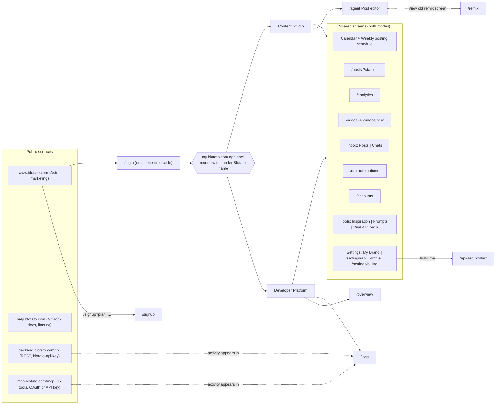

# 02 - Blotato Navigation Map (Phase 1, pass 1)

> **Update (pass 2):** all routes below, including Calendar, Inbox, `/inspiration`, `/prompts`, `/labs/viral-coach`, and `/settings/*`, are now CONFIRMED live. `/videos` redirects to `/videos/new`. See [05-authenticated-findings.md](05-authenticated-findings.md) and [diagrams/navigation-map-confirmed.mmd](diagrams/navigation-map-confirmed.mmd).

Session: unauthenticated. Routes come from three source types, each tagged:
- **B** = CONFIRMED in shipped JS bundles on `/login`
- **D** = DOCUMENTED, i.e. a link to `my.blotato.com/...` in help.blotato.com
- **I** = INFERRED

None of the logged-in routes have been rendered yet.

## Route table

| Route | Screen | Mode | Source | Notes |
|---|---|---|---|---|
| `/login` | Sign in (email one-time code) | logged-out | B (route group `app/(logged-out)/login`), observed live | Only page rendered this pass |
| `/signup?plan=<plan>&ref=<code>` | Sign up | logged-out | D (marketing CTAs) | Plan slug e.g. `starter-monthly` |
| `/overview` | Overview | Developer Platform | D | Week posts, upcoming, DM automations, platform performance |
| `/logs` | Logs | Developer Platform | D | Filters + raw request/response + Copy request ID |
| `/agent` | Post editor (in-app AI Agent) | Content Studio | D | Brand, Context, "Write posts about..." |
| `/remix` | Old Remix screen | Content Studio (legacy) | D | Reached via "View old remix screen"; some "Move to drafts" actions open it |
| `/videos/new` | Create New Video (template chooser) | Shared | D | List page path INFERRED `/videos` |
| `/posts` (`?status=published` etc.) | Posts | Shared | D | All / Scheduled / Published / Failed |
| `/analytics` | Analytics | Shared | D | 7d / 30d / All time |
| `/dm-automations` | DM automations | Shared | D | List + flow editor (sub-route UNVERIFIED) |
| `/accounts` | Accounts | Shared | B + D | Connect / reconnect / IDs |
| `/settings/api` | Settings → API | Settings | D | Credentials + client setup |
| `/settings/billing` | Settings → Billing | Settings | B + D | Plans, credits (Stripe) |
| `/api-setup?start` | API setup wizard | Onboarding | D | Contract has `users/me/api-setup/{start,skip,complete,account,tool}` |
| Calendar | Calendar + Weekly posting schedule | Shared | D (screen), I (`/calendar`) | |
| Inbox | Inbox (Posts / Chats tabs) | Shared | D (screen), I (`/inbox`) | |
| Tools → Inspiration / Prompts / Viral AI Coach | Tools | Shared | D (screens), routes unknown | |
| Settings → My Brand / Profile | Settings | Settings | D (screens), routes unknown | |

## Mode / navigation diagram

A copy of the diagram is in [diagrams/navigation-map.mmd](diagrams/navigation-map.mmd).

## Legacy → current mapping (DOCUMENTED, help navigation.md)

| Earlier location | Current location |
|---|---|
| Settings > Social Accounts / Accounts / Add a new account | Accounts > Connect account |
| Upcoming Posts | Posts > Scheduled, or Calendar |
| Published / Failed Posts | Posts > Published / Failed (+ Logs) |
| Published Posts > Top Performing | Analytics > Top posts |
| Calendar (BETA), Weekly schedule page | Calendar (> Weekly posting schedule) |
| AI Agent in main menu | Content Studio > Post editor |
| Inspiration / Prompts / Viral AI Coach in main menu | Tools > … |
| Settings > General | Settings > Profile |

This mapping shows the product was recently redesigned. Old screens such as `/remix` still exist, so expect legacy routes in the bundles once you are authenticated.

## Open navigation questions (need auth)

1. Actual paths for Calendar, Inbox, Tools, My Brand, Profile, Video list/editor, DM flow editor, Viral Coach detail.
2. Whether the mode is stored client-side (localStorage/Jotai atom) or server-side (`/me/preferences`).
3. Deep links and dynamic segments (e.g. `/videos/:id`, `/dm-automations/:flowId`).
4. Role/plan gating of nav items (trial vs paid, team members).
